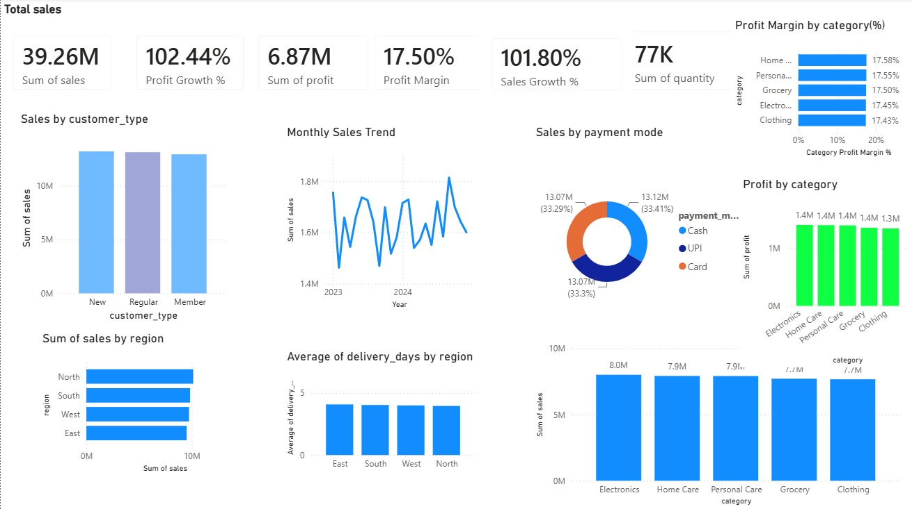
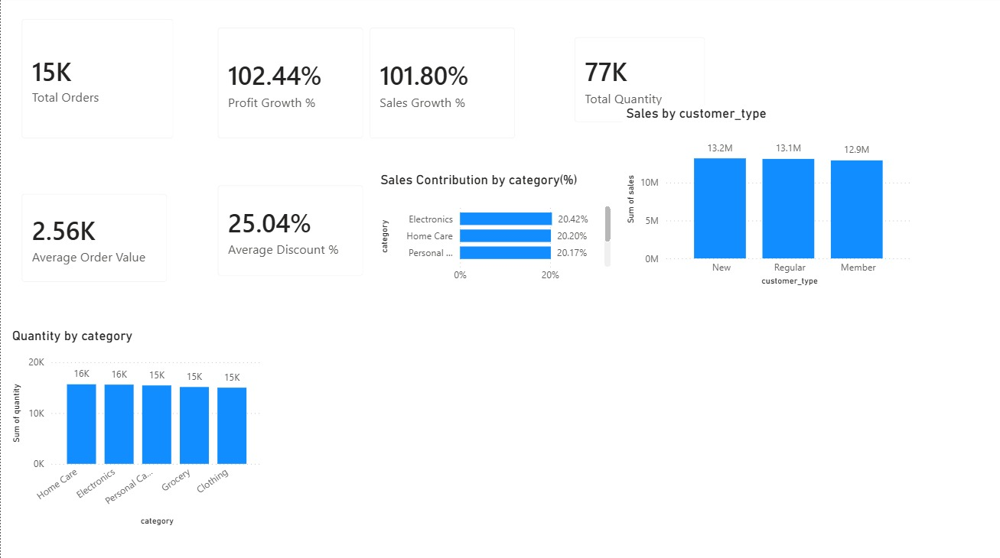

DMart Retail Sales, Profitability and Customer Analytics

Project Overview

This project analyses DMart retail sales, profitability and customer purchasing patterns using Excel, MySQL and Power BI.

The objective is to understand sales performance, identify profitable product categories and generate useful business insights through data analysis and interactive dashboards.

Tools and Technologies

- Microsoft Excel: Data cleaning and preparation
- MySQL: Data querying and analysis
- Microsoft Power BI: Data visualisation and dashboard development
- DAX: Calculated measures and business metrics

Dataset Description

- Dataset: DMart Retail Sales
- Records: 15,345 rows
- Columns: 12
- Domain: Retail Analytics

Project Work

1. Data Cleaning – Excel

- Checked and removed duplicate records, where applicable.
- Checked missing values.
- Verified date formats.
- Checked extra spaces and data consistency.

2. Data Analysis – MySQL

- SELECT, WHERE and ORDER BY
- GROUP BY and HAVING
- Aggregate functions
- Business-related sales analysis

3. Dashboard Development – Power BI

Created interactive reports to analyse:

- Total Sales
- Total Profit
- Profit Margin
- Total Orders
- Total Quantity
- Average Order Value
- Average Discount
- Category-wise performance
- Region-wise sales
- Monthly sales trends
- Customer type and payment method analysis

Key Project Results

Metric| Result
Total Sales| 39.26 Million
Total Profit| 6.87 Million
Profit Margin| 17.50%
Total Orders| Approximately 15K
Total Quantity| Approximately 77K
Average Order Value| Approximately 2.56K
Average Discount| 25.04%

Key Business Insights

- Electronics recorded the highest sales contribution among the categories analysed.
- Electronics also recorded the highest category profit.
- New customers contributed approximately 13.2 million in sales.
- Home Care recorded the highest quantity sold among the categories analysed.
- Monthly and regional sales patterns were explored using Power BI visualisations.

Project Files
- `DMart cleaned.xlsx` – Cleaned dataset prepared using Microsoft Excel.
- Power BI dashboard: "DMart_Retail_Analytics_Dashboard.pbix"
- Final project report: "DMart_Retail_Analytics_Project_Report_Final.pdf"

Conclusion

This project provided practical experience in data cleaning, SQL querying, data modelling, DAX calculations and business intelligence dashboard development.

It demonstrates how data analytics tools can help businesses understand sales performance and make informed decisions.

Author

Guruprasad

## Power BI Dashboard Screenshots

### 1. Executive Dashboard

### 2. DAX Analysis Dashboard

Aspiring Data Analyst | Excel | MySQL | Power BI
